<p align="center">
  
</p>

<p align="center">
  
  &nbsp;
  
  &nbsp;
  
  &nbsp;
  
  &nbsp;
  
</p>

<h1 align="center">Merchant Saathi 🧁</h1>

<p align="center"><b>An AI business partner for a bakery's quiet afternoons.</b><br/>
A dashboard tells a merchant that orders are down. It never tells them <b>what to do about it</b>, whether the fix is <b>affordable</b>, what to <b>say to customers</b>, or whether it <b>worked</b>. Merchant Saathi closes that entire loop - and proves every single number on the way.</p>

<p align="center">
  
</p>

<p align="center">
  <a href="#-the-problem-in-real-numbers">The Problem</a> •
  <a href="#-the-solution-one-honest-loop">The Solution</a> •
  <a href="#-feature-deep-dive">Features</a> •
  <a href="#-architecture">Architecture</a> •
  <a href="#-whats-real-vs-simulated">Honesty Ledger</a> •
  <a href="#-api-reference">API</a> •
  <a href="#-run-it-in-10-minutes">Run It</a> •
  <a href="#-testing--verification">Tests</a> •
  <a href="#-roadmap">Roadmap</a> •
  <a href="#-team-finovatex">Team</a>
</p>

---

## 🎯 The problem, in real numbers

Our hero user is a Pune bakery owner. Between the two most recent complete Mon–Fri windows, completed **3–6 p.m. orders fell from 100 to 70 (−30%)** and net sales from **₹8,000 to ₹5,600**. Average order value stayed flat at **₹80** — so the problem is **order count, not basket size**.

A dashboard alone just shows the decline. The owner is still stuck with five unanswered questions:

| # | Question a real owner asks | What most tools do | What Merchant Saathi does |
|---|---|---|---|
| 1 | *What exactly changed, and since when?* | Dumps charts | One opportunity with **evidence receipts** — every number links to a metric id, definition, window and source |
| 2 | *What should I do about it?* | Generic tips | One concrete, capped offer: **two samosas + one tea at ₹70** (usual ₹90) |
| 3 | *Can I afford it?* | Hopes you do the math | **Code, not AI**, computes margin (42.9% vs a 25% floor), stock capacity (25 bundles) and maximum discount exposure (₹400) — an unsafe ₹50 is **visibly rejected** |
| 4 | *What do I tell customers?* | Leaves copywriting to you | The AI drafts the explanation + customer message **from the verified numbers only**, English or Hindi |
| 5 | *Did it work?* | Silence | Owner approval → **simulated** outbox → 10 redemption events → **₹700 − ₹400 = ₹300 contribution**, every screen labeled |

> ⚠️ **What we refuse to do:** no causal claims (we say orders *fell*, never *because of weather*), no invented lift percentages, no real messages, no fake "AI magic". The product can also say **"insufficient evidence"** and refuses to guess — that refusal is a feature, not a limitation.

## 💡 The solution - one honest loop

<p align="center">
  
</p>

Every stage of the loop is engineered so the **owner stays in control** and the **AI stays in its lane**:

1. **Inspect** — the dashboard tells the story at a glance (interactive metric switcher, per-day bars with hover tooltips, campaign funnel strip). The opportunity page opens the **evidence drawer**: six numbered checks, each with its metric id (`afternoon-order-delta-v1`, `bundle-margin-v1`, …), exact value, definition, period and source table.
2. **Price** — edit price and cap in the offer workspace; margin, capacity and exposure **recompute instantly in pure functions**. Try ₹50: the meter drops below the floor line and the approve button locks.
3. **Approve** — the approval binds the **exact preview** with a SHA-256 payload hash. Any later change to price, stock or consent invalidates it — a stale execute is refused with `409 stale_preview`.
4. **Queue (simulated)** — 40 consented demo customers enter a simulated outbox inside one `BEGIN IMMEDIATE` transaction, with per-recipient idempotency keys. Nothing is ever really sent.
5. **Measure** — apply 10 simulated redemption events; replays are idempotent; the cap is enforced atomically; the waterfall shows exactly where the money went.

<p align="center">
  
</p>

## 🚀 Feature deep dive

### 📊 1. The one-glance dashboard
<p align="center">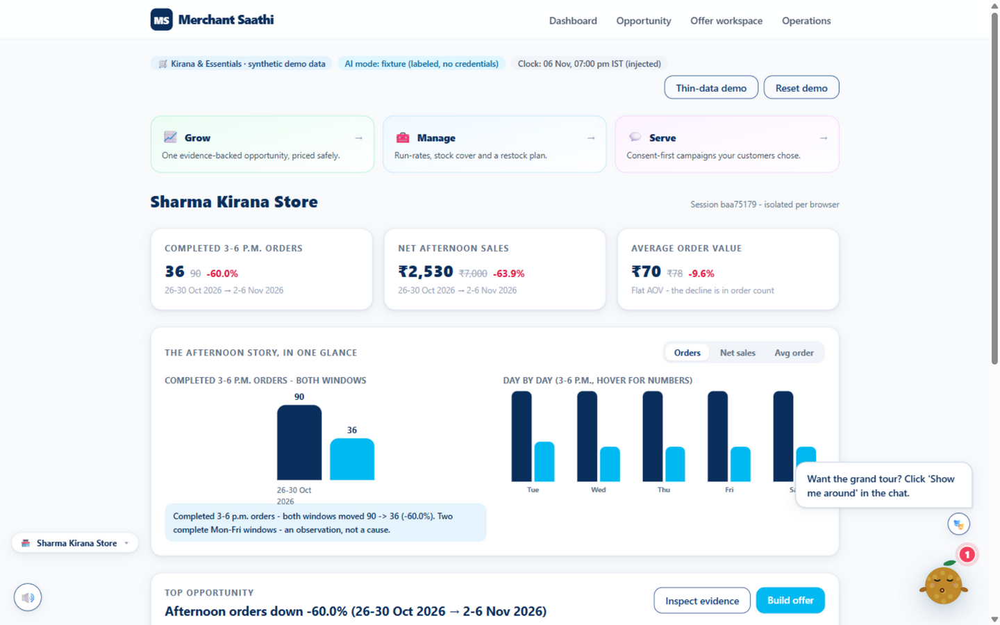</p>

Count-up KPI cards, an interactive **metric switcher** (Orders / Net sales / Avg order) that rewrites the story line, **day-by-day 3–6 p.m. bars with hover tooltips** (both windows, per weekday — straight from `/api/demo/insights`, computed from order rows), and a **campaign funnel strip** that fills in as you act: customers → consented → simulated outbox → redemptions → ₹300 contribution. Zero chart libraries — every pixel is hand-rolled SVG/CSS fed by server-computed DTOs.

### 🔍 2. Evidence receipts (the USP)
<p align="center">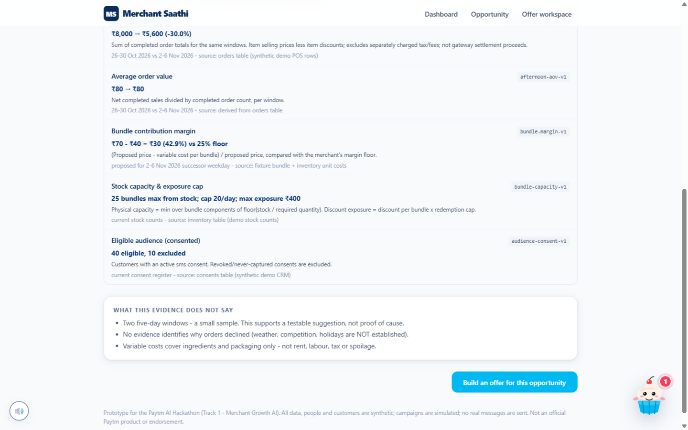</p>

Six evidence checks, each traceable: label, id, exact value, plain-language definition, the window it covers, and the source table it came from. Below it, an explicit *"What this evidence does NOT say"* panel — small sample, no proof of cause, variable costs exclude rent/labour/tax.

### 🧮 3. The offer workspace with live guardrails
<p align="center">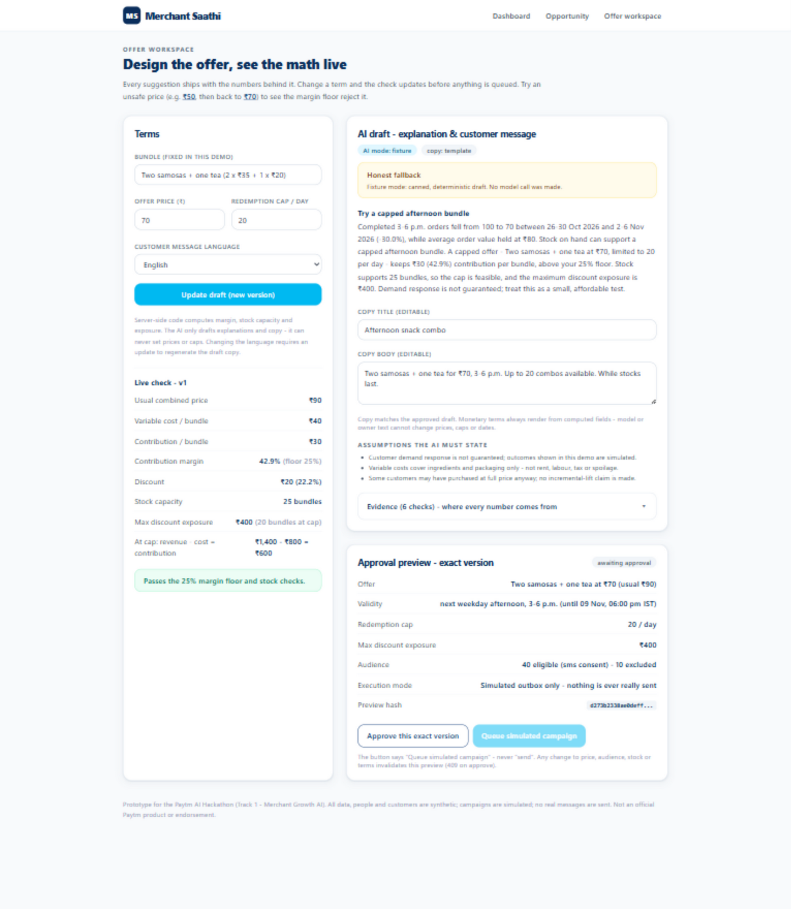</p>

Live **margin-vs-floor meter** and **cap-vs-capacity meter**. Type ₹50 and watch it break:

<p align="center">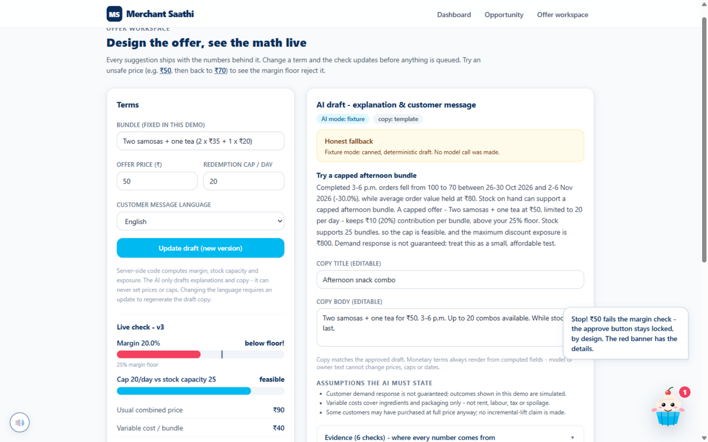</p>

Approve stays disabled, nothing can be queued, and the mascot visibly panics. The AI drafts explanation + customer copy (English/Hindi) **from the computed numbers only** — its output is schema-validated, its rupee amounts are cross-checked against the computed facts, and any violation falls back to a labeled template. Monetary terms in copy can never contradict the math.

<p align="center">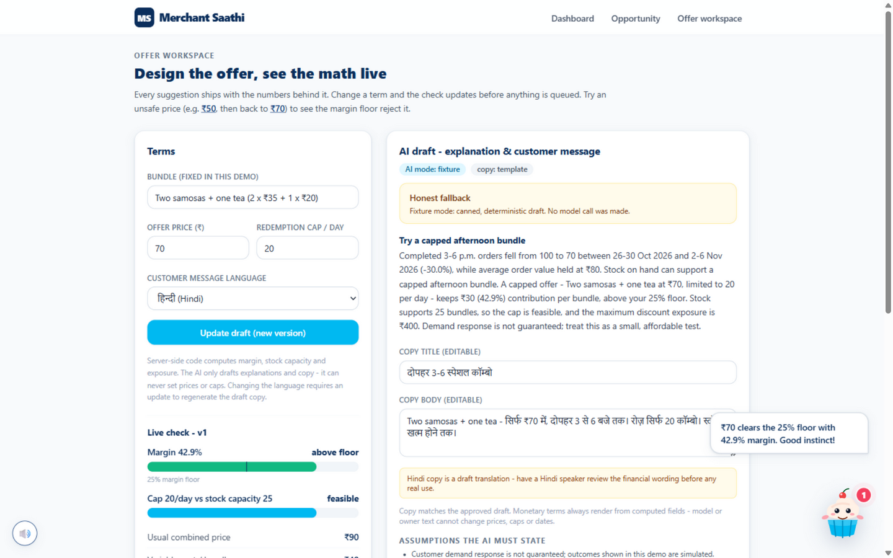</p>

### 🔐 4. Hash-bound approval → simulated outbox
<p align="center">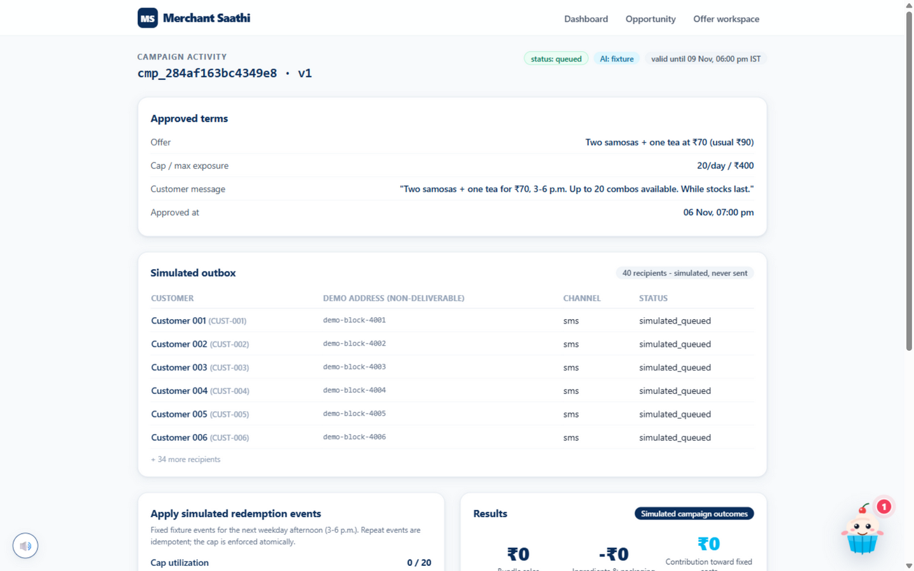</p>

Approving binds version + price + cap + audience hash + inventory version. Execution re-checks **all of it** — stale inventory, stale consent, expired validity and reused idempotency keys all fail loudly with typed error codes. The outbox is honest: `simulated_queued`, non-deliverable demo addresses, never sent.

### 💰 5. Results with a money waterfall
<p align="center">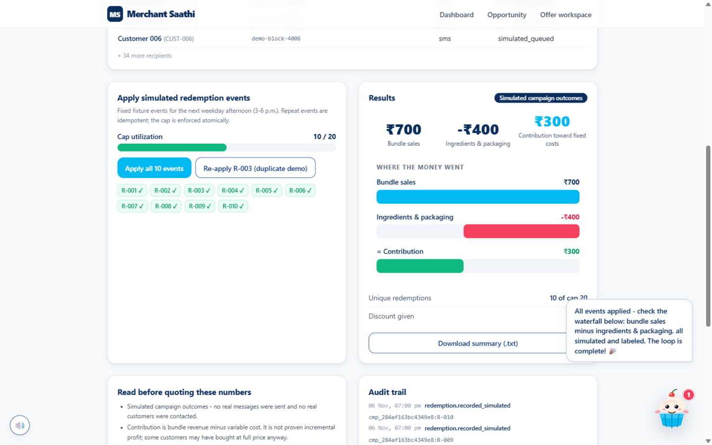</p>

₹700 bundle sales − ₹400 ingredients & packaging = **₹300 contribution toward fixed costs**. Replay R-003 and the app proves idempotency live: *"replaying it changed nothing."* A downloadable `.txt` summary carries the caveats with the numbers.

### 🪞 6. The honesty ledger — "insufficient evidence" on demand
<p align="center">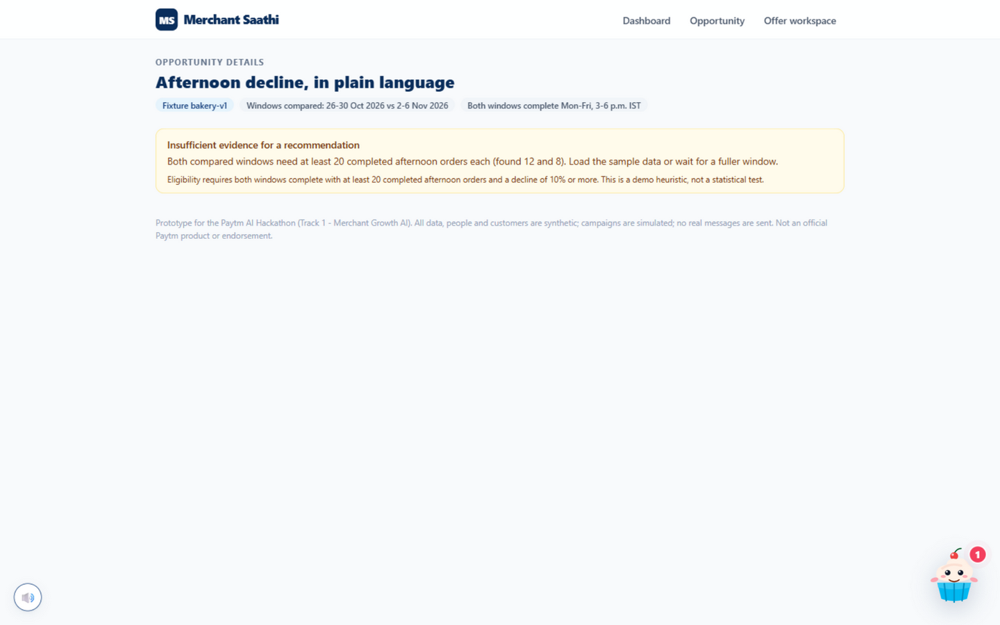</p>

One click loads the **thin-data demo**: tiny windows, and the app flatly refuses to recommend — *"Both compared windows need at least 20 completed afternoon orders each (found 12 and 8)."* Drafting via the API is refused too (`422 business_rule`). A product that can say "I don't know" is more trustworthy than one that always answers.

### 🎭 7. Six mascots, 24 signature animations, 24 unique voices
<p align="center">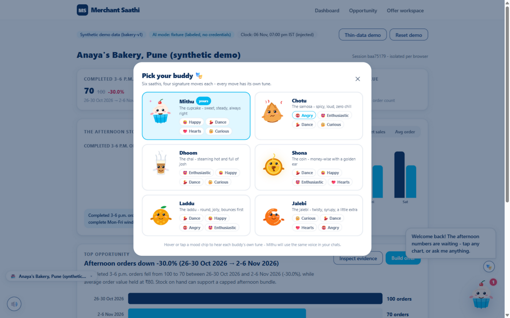</p>

| Buddy | Is | Signature moves |
| --- | --- | --- |
| **Mithu** | cupcake | happy · dance · hearts · curious |
| **Chotu** | samosa | angry · enthusiastic · dance · curious |
| **Dhoom** | chai glass | enthusiastic · happy · dance · curious |
| **Shona** | rupee coin | dance · happy · enthusiastic · hearts |
| **Laddu** | laddu | dance · happy · angry · enthusiastic |
| **Jalebi** | jalebi | curious · dance · hearts · angry |

Every mascot × mood pair has its **own synthesized tune** — the same melody is a sweet sparkle on Mithu and a raspy shout on Chotu (voice = waveform + transposition + tempo + flourish: sparkle, pop, steam, coin, bounce, swirl). The buddy guides the whole product: speech bubbles, a **spotlight guided tour** on every screen, and live reactions — celebrates approvals, panics at unsafe prices, explains 409s.

### 💬 8. Mithu's chat — grounded answers, optional live brain
Ask *"why are orders down?"*, *"is ₹70 safe?"*, *"what did the campaign earn?"* — the built-in **fact book** answers from the session's verified numbers with a *How I reasoned* trace. Paste a provider API key + model in the 🧠 dialog and answers become generative with deeper reasoning — still guarded: any rupee amount the model invents that isn't in the computed facts makes the reply fall back to the fact book with a labeled note. The key lives in **server memory only** (never disk, masked to the browser, public-host validated).

### 🏪 9. Multiple businesses, zero tedium
The 🏪 strip adds, switches and removes businesses in one click — each with its own deterministic synthetic numbers, consent register, offers and campaigns (up to 6 per session). Requests carry the active business id and the server honors **only ids owned by your session**. Stale selectors self-heal; the same client idempotency key never collides across businesses.

## 🏗 Architecture

<p align="center"></p>

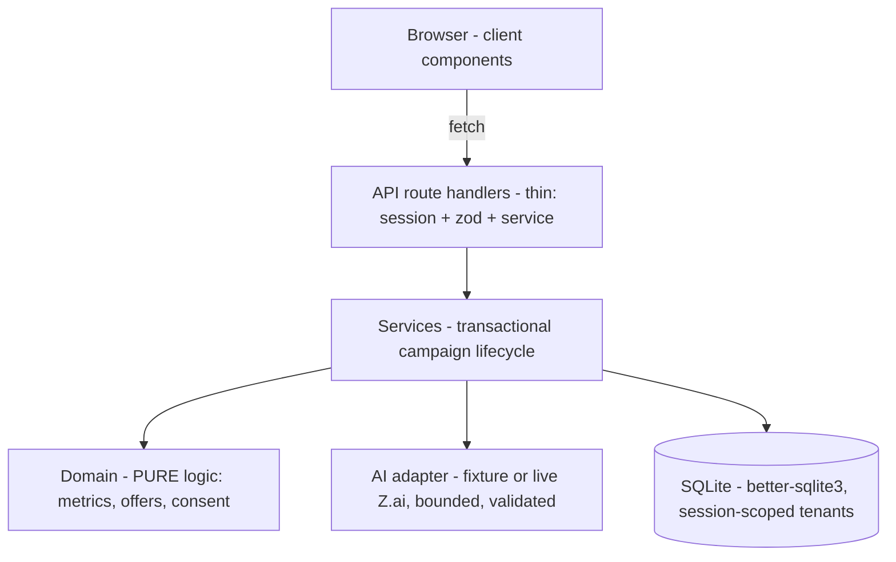

**Why it holds up under pressure:**

- **Money is integer paise everywhere.** ₹70 = `7000`. Formatting happens only at the UI edge. The AI never performs arithmetic — `computeOffer()` is the only place offer economics exist.
- **Sessions isolate tenants.** Each browser gets an httpOnly session cookie mapping to its own merchants; multi-business requests carry a selector that is honored **only** when the row belongs to that session. Foreign ids resolve to `404` without leaking existence.
- **The AI adapter is bounded.** 15s timeout, one retry, Zod-validated response, evidence-id allowlist, rupee-term guard, and it can only ever return prose — money, stock, consent and execution state are unreachable from the model.
- **Config is guarded.** The database path must stay inside the project folder; the model endpoint must be a public http(s) host — loopback/private IPs, encoded addresses and redirects are refused (see `tests/security-guards.test.ts`).
- **Zero chart/animation dependencies.** All visuals are hand-rolled SVG/CSS and honor `prefers-reduced-motion`; all sound is synthesized Web Audio with a compressor on the master bus — no audio files, nothing downloaded.

<details>
<summary><b>📂 Project layout (click to expand)</b></summary>

```
src/
  app/                     pages + API route handlers (thin)
    api/...                demo/state|reset|insights, merchants, campaigns/*, assistant/*
    merchant/              dashboard, opportunity, offer workspace
    campaigns/[id]/        activity, simulated outbox, redemptions, results
  components/              mascot cast (6 SVG characters), picker, provider/chat/tour,
                           charts (GroupedBars, Meter, Donut, Waterfall, DayBars, Funnel), ui primitives
  domain/                  metrics, offers, consent (pure business logic)
  services/                campaigns lifecycle, demo state, multi-merchant resolution
  adapters/ai.ts           bounded AI adapter: fixture | live Z.ai | labeled fallback
  lib/                     db, clock (IST windows), money (paise), seed (deterministic variants),
                           saathi-brain (fact book + live prompts + rupee guard), mascots-config, sound
  fixtures/bakery-v1.json  single source of truth for every demo number
scripts/                   seed CLI + fixture verifier
tests/                     vitest suites (88) + playwright e2e hero flow
docs/                      screenshots of every stage + animations + team context pack
```
</details>

## 📡 API reference (all session-scoped, JSON)

| Route | Method | Purpose |
| --- | --- | --- |
| `/api/demo/state` | GET | Bootstrap: seeded state, KPIs, merchants, AI mode |
| `/api/demo/reset` | POST | Reseed **this session's active business** |
| `/api/demo/insights` | GET | Per-day 3–6 p.m. totals + campaign funnel |
| `/api/merchants` | GET / POST | List businesses / add one (cap 6, deterministic variant) |
| `/api/merchants/{id}` | DELETE | Remove an owned business and all its rows |
| `/api/opportunities` | GET | Evidence-backed opportunities (or the low-data reason) |
| `/api/campaigns/draft` | POST | New draft version: computed terms + AI copy + previewHash |
| `/api/campaigns/{id}/approve` | POST | Bind the exact preview hash; stale → `409` |
| `/api/campaigns/{id}/execute` | POST | Transactional simulated queue; idempotent; re-checks everything |
| `/api/demo/campaigns/{id}/redeem` | POST | Fixture event ids only; replays idempotent; cap enforced |
| `/api/campaigns/{id}/results` | GET | Activity + simulated outcomes + audit trail |
| `/api/assistant/chat` | POST | Fact-book answers or rupee-checked live model replies |
| `/api/assistant/settings` | GET/POST/DELETE | Chat brain key: server memory only, masked, public-host validated |

Errors always follow one envelope: `{ "error": { "code", "message", "fieldErrors?" } }` with meaningful status codes (`400/401/403/404/409/422/429/503`).

## 🪞 What's real vs simulated

| ✅ REAL (computed in tested code) | 🏷️ SIMULATED (labeled on every screen) |
| --- | --- |
| Sales metrics, window math (5 daily 3–6 p.m. IST bands — not continuous ranges!) | The bakery dataset (`bakery-v1` fixture, seeded PRNG) |
| Offer economics, capacity, discount exposure | The customer list and consent register (50 fake IDs) |
| Consent filtering + audience hashing | Message delivery (outbox — never sends) |
| Approval hash binding, idempotency, cap enforcement | Redemption events (10 fixed fixture events) |
| Results arithmetic | The clock (pinned to Fri 6 Nov 2026, 7:00 PM IST) |

AI: drafts explanation + customer copy only, from verified facts — fixture mode (default, no credentials) or live Z.ai.

## 🧪 Testing & verification

- **88 unit tests** (Vitest): money, band filtering, margin floor, missing-cost, cap-vs-capacity, approval hash binding, stale consent/inventory, duplicate execute/redeem, key-reuse conflicts, AI guardrails, thin-data refusal, draft opportunity guard, config guards, multi-business caps/ownership/isolation, insights reconciliation, assistant fact book + rupee guard.
- **1 Playwright e2e**: the full hero path — load → −30% → draft → ₹50 rejected → restore → approve → queue → 10 events → ₹300 → idempotent replay.
- **`npm run fixtures:verify`**: reconciles every fixture number against the database — the pre-demo gate. It once caught a real data-loss bug in our own migration; that fix (FK-suspended table rebuild + husk self-heal) is now permanent.

```bash
npm run fixtures:verify && npm test && npm run lint && npm run typecheck && npm run build
```

## 🚀 Run it in 10 minutes

```bash
git clone https://github.com/Arya-jannawar/merchant-saathi.git
cd merchant-saathi
npm install
cp .env.example .env.local      # defaults are safe; no API key needed
npm run db:seed
npm run fixtures:verify         # must print: All fixture checks passed.
npm run dev
```

Open **http://localhost:3000/merchant**, click **Load sample data**, and follow Mithu (the 🗺 tour button walks you through every screen). Optional live AI: set `AI_MODE=live` + `ZAI_API_KEY` + `ZAI_MODEL`, or paste a key in the chat's 🧠 dialog. Node 20+, nothing else to install.

<details>
<summary><b>🕹️ The 3-minute demo script (click to expand)</b></summary>

1. **Dashboard (30s)** — the decline: 100 → 70 orders, ₹8,000 → ₹5,600, flat ₹80 AOV. "The problem is order count, not basket size."
2. **Opportunity (30s)** — open the evidence drawer. "Every number has a receipt. We never say *why* — two windows can't prove cause."
3. **Offer workspace (60s)** — type **50**. The meter drops below the floor, approve locks. Back to 70: 42.9% margin, cap 20, exposure ₹400. "Code does the math. The AI only writes words."
4. **Approve & queue (30s)** — hash-bound approval, 40 consented customers, *simulated* outbox. Replay R-003: *"changed nothing."*
5. **Results (30s)** — ₹700 − ₹400 = ₹300 contribution. "Honest labels everywhere. That's the product."

</details>

## 🗺 Roadmap

- [x] Hero loop end-to-end + thin-data refusal + Hindi copy
- [x] Mascot cast, guided tour, sound kit, infographic dashboard
- [x] Multi-business sessions with ownership guards
- [ ] Live-AI smoke test with real credentials (fallback path is already honest)
- [ ] CSV import with per-row validation and rejected-row report
- [ ] Hosted deployment (single Node process + durable disk; real auth first)

**Pilot plan:** 3–5 Pune bakery owners · measure time-to-prepare an offer, pricing errors, comprehension of evidence · pricing validated only after real trials.

## 👑 Team FinovateX

<p align="center">
  
</p>

| | | |
|:---:|:---:|:---:|
| **Avani Jannawar** | **Siddhant Pardeshi** | **Arya Jannawar** |
| Product & QA · mascot cast, animation & sound system, visual identity | Systems & hardening · multi-business engine, idempotency, migration safety | AI & core engine · evidence pipeline, offer guardrails, bounded adapter |

<p align="center">
  
</p>

<p align="center">
  <sub><b>Watch the rejection loop once more.</b> That stamp is the whole product: the app would rather say <i>no</i> — on camera, with receipts — than guess.<br/>
  Star ⭐ the repo if a product that refuses to lie hooked you too.</sub>
</p>

<p align="center">
  
</p>

---

<p align="center">
  <sub>All data, people and customers are synthetic. Campaigns are simulated. No real messages are ever sent.<br/>
  Not an official Paytm product and claims no endorsement. Built with 🧁, ☕ and honesty by Team FinovateX.</sub>
</p>
